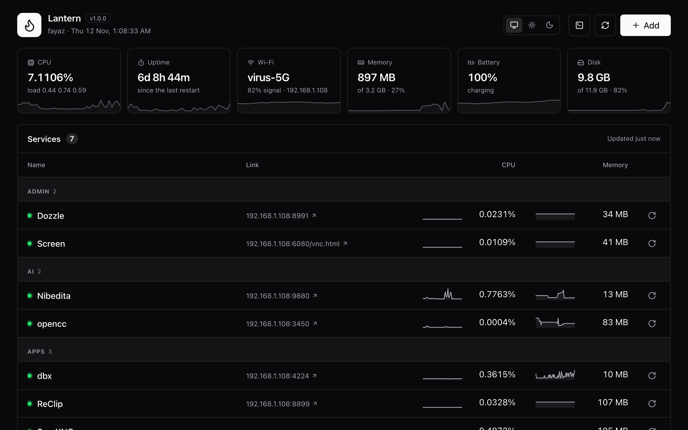
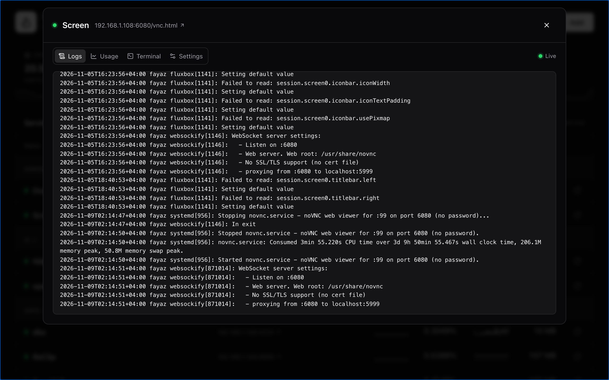
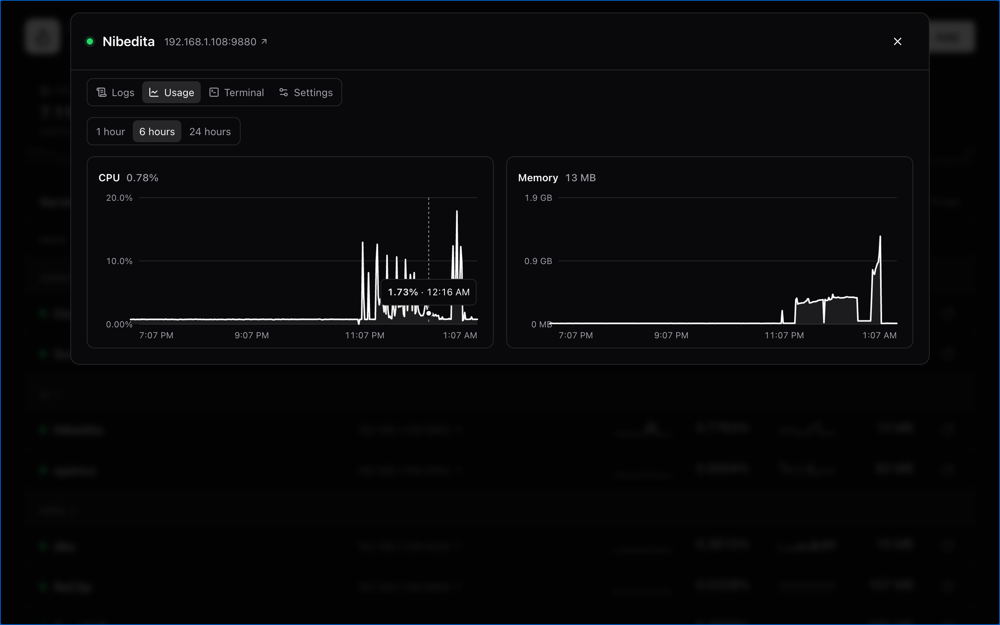
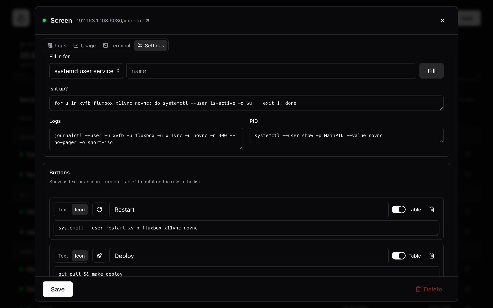
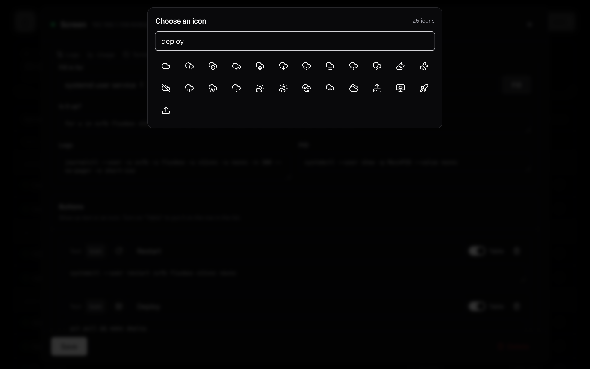
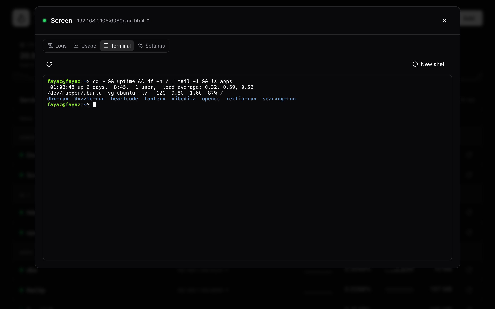
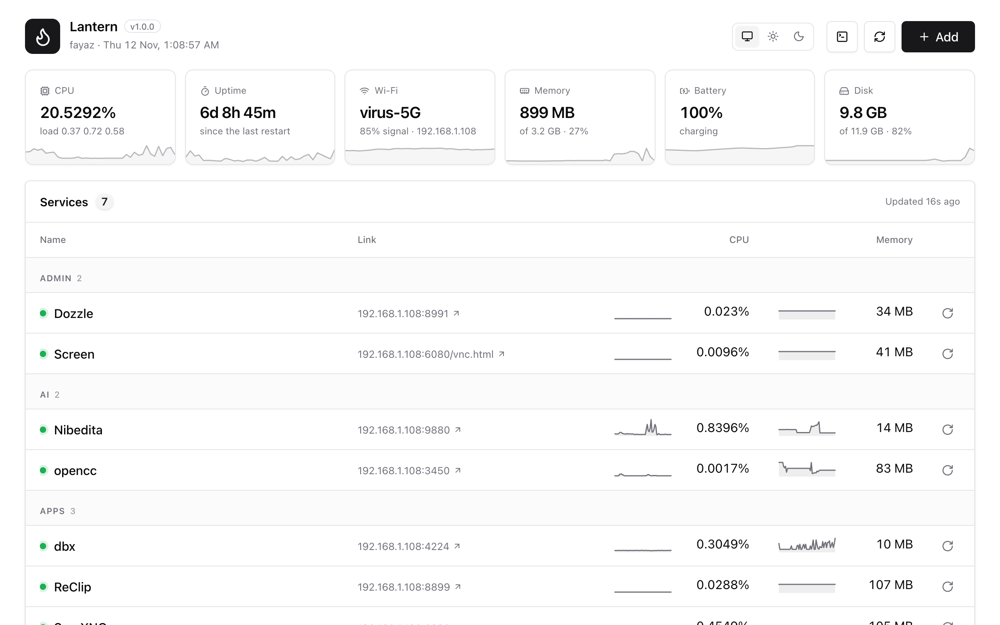
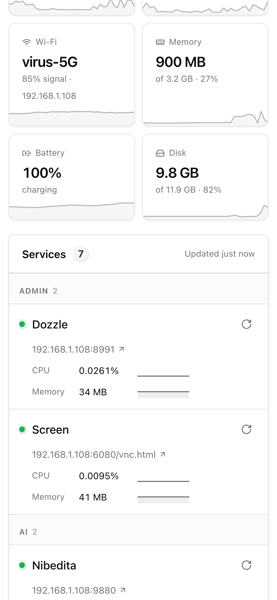

# Lantern

**One page to watch and control everything running on your Linux box.**
Two files, no install, no database, no Docker. Just a bash script and an HTML page.



You have a little server at home (an old laptop, a Raspberry Pi, a mini PC) running a
handful of things: a few containers, a couple of systemd services, a script or two. To
check on them you SSH in, try to remember the service name, `journalctl` this, `podman
logs` that, restart something, forget what port it was on.

Lantern puts all of that on one page you can open from your phone.

1. **See everything at a glance.** Each service is a row: green or red, its link, and
  how much CPU and memory it is using. The top shows the machine itself: CPU,
  memory, disk, uptime, Wi-Fi, battery.
2. **Fix things in one click.** Put a Restart (or Deploy, or anything) button right on
  the row. Click it, a spinner turns, you get a "done" or the error.
3. **See how things have been doing.** Small graphs show the last hour of CPU and
  memory for every service, and the last day for the machine. Open a service for
  bigger 1, 6 and 24-hour charts.
4. **Read the logs.** Live, updated every second, while you look at them.
5. **A real terminal in the browser.** `git pull` asks for a password? Type it.
  Ctrl-C, tab completion, colours, history all work.
6. **Works with anything.** Lantern doesn't know about Docker or systemd. You tell it
  a few shell commands per service, so it works for containers, services, plain
  processes, cron jobs, a game server, whatever. There are one-click templates for
  the common ones.





## Get it running

You need Linux with bash and busybox (both already there on Ubuntu and Debian).

```bash
git clone https://github.com/p32929/lantern.git && cd lantern
./lantern.sh
```

It asks three things:

```
Setting up Lantern.
Port [80]:
PIN to open Lantern (empty = no PIN: anyone who can reach the port gets in):
Keep it running always (starts on boot, comes back if it crashes)? [Y/n]:
Running: http://192.168.1.20:80
```

Open that address from any device on your network. That's it.

## Add your first service

Click **Add**, give it a name, and either pick a template or write the commands
yourself. Every field is optional.

| Field      | What it does                                   | Example                                    |
| ---------- | ---------------------------------------------- | ------------------------------------------ |
| Link       | Where the name links to                        | `http://{host}:8080`                       |
| Folder     | Where its commands and terminal start          | `~/apps/blog`                              |
| Is it up?  | Exits 0 when it's running                      | `systemctl --user is-active -q blog`       |
| Logs       | Prints the latest logs                         | `journalctl --user -u blog -n 300`         |
| PID        | Prints its process ID, for CPU and memory      | `systemctl --user show -p MainPID --value blog` |
| Buttons    | Anything you want one click away               | `git pull && npm ci && systemctl --user restart blog` |

**Templates** fill all of that in from just a name: systemd user service,
systemd service, podman container, docker container, or any process.

**Buttons** can show as text or as an icon. Pick from 1,600+ icons with a search
("deploy" finds rockets and uploads, "restart" finds the arrows). Flip
**Table** on to put the button right on the row.





Handy tricks:

1. `{host}` in a link becomes whatever address you opened Lantern with, so the same
  link works from home Wi-Fi and from a VPN.
2. A link that starts with `$ ` is a command, and its output becomes the link. Good
  for apps whose login token changes on every restart.
3. Groups turn the table into sections (Apps, Media, Admin…).

## The terminal

Every service has a **Terminal** tab: a real shell on the server, already in that
service's folder. Your buttons sit above it and type their command into it, so you
see it run and can answer any prompt. There's also a plain terminal in the top bar.

The shell keeps running when you close the page. Come back later and it's where
you left it.



## Managing it

Run the script again for a small menu, or use a command directly:

```bash
./lantern.sh            # status, then: restart, stop, start, change port, change PIN, update, uninstall
./lantern.sh restart
./lantern.sh stop
./lantern.sh status
./lantern.sh port       # change the port
./lantern.sh pin        # change the PIN
./lantern.sh update     # copy newer lantern.sh / lantern.html into place
./lantern.sh uninstall  # asks whether to keep the services you added
./lantern.sh version    # which version you have (also shown next to the name on the page)
```

Light, dark and follow-the-system themes are in the top bar.



On a phone every service becomes a small card with the same information:



## How it works

There is no daemon of its own and nothing to compile.

1. **busybox httpd** (already on Ubuntu/Debian) serves `lantern.html` and runs
  `lantern.sh` for every request the page makes, the old-school CGI way.
2. **Your services are folders of plain text files** in `~/.lantern/items/`. One
  file per field. Back them up, edit them by hand, or copy them to another machine.
3. **CPU and memory** come from the service's cgroup (so a container or a
  multi-process service is counted as a whole), falling back to the single process.
4. **History** is one line a minute per service in `~/.lantern/history/`, kept
  for 24 hours, recorded by a small loop that runs next to the web server.
5. **The terminal** is a real pseudo-terminal (`script` from util-linux) fed
  through a named pipe, drawn in the browser with xterm.js.
6. **Always on** is a systemd user service with `Restart=always`, started at boot.
  On a machine without systemd it runs in the background instead.

The page loads [Franken UI](https://franken-ui.dev) and
[xterm.js](https://xtermjs.org) from a CDN, so the browser you open it in needs
internet. The server doesn't.

## Security

Lantern is made for your home network.

1. **Everything needs the PIN**, looking included: the list, stats, logs, graphs,
  buttons and the terminal. Until it's entered the page shows nothing and the
  server answers nothing. It's asked once, and that browser stays trusted until
  the machine reboots or you change the PIN.
2. **5 wrong PINs and that device is locked out** (by IP address) for 7 days.
  **20 wrong PINs in total**, from any mix of addresses, turn PIN logins off
  altogether (browsers already in keep working), so guessing can't be spread
  over many addresses. Only starting Lantern again clears both: run
  `./lantern.sh restart` on the server, or reboot. `./lantern.sh status` lists
  who's blocked.
3. Lantern's files (your commands, logs, terminal output) can only be read by
  your user, not by other accounts on the machine.
4. The page refuses to run inside another site's frame, only links to web
  addresses, and the browser checks every file it loads from the CDN against a
  fixed fingerprint.
5. Commands and the terminal run as **your user**. Someone with the PIN has a shell
  as you.
6. It's plain HTTP, so the PIN travels unencrypted. Don't open it to the
  internet. If you need it away from home, use a VPN like Tailscale or
  WireGuard, or an SSH tunnel: `ssh -L 9999:localhost:9999 you@server`, then
  open http://localhost:9999.

## Requirements

1. Linux with bash 4+, busybox, and util-linux (`script`, `setsid`)
2. systemd, for start-on-boot (optional)
3. Any modern browser

Tested on Ubuntu Server on a Chromebook with 3 GB of RAM. It's light enough to
sit on very small machines.

## Files

```
lantern.sh     the setup script, and the page's backend
lantern.html   the page
CHANGELOG.md   what changed in each version
```

## Contributing

Contributions are very welcome, thank you! Before you start on a pull request, please open an issue and tell me what you would like to add or change. That way we can agree on it first, and your time is not wasted on something that might not fit. Thanks for helping make Lantern better.

## Share

<a href="https://p32929.github.io/share/?repo=lantern"><picture><source media="(prefers-color-scheme: dark)" srcset="https://p32929.github.io/readme/share-dark.svg"></picture></a>

## Support

<a href="https://p32929.github.io/support/"><picture><source media="(prefers-color-scheme: dark)" srcset="https://p32929.github.io/readme/support-dark.svg"></picture></a>
